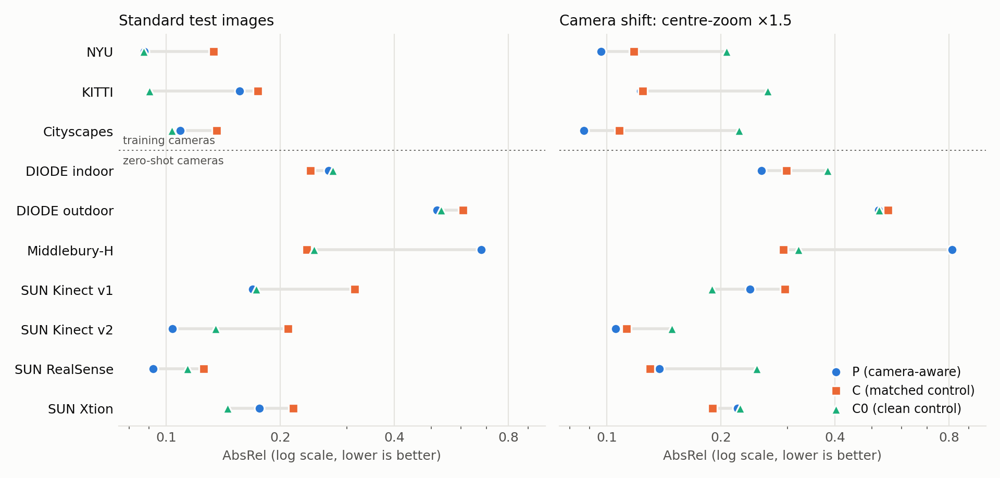

# Multi-domain metric depth with camera intrinsics (2026-10-29)

## Question

Earlier results showed the camera-aware model (camera token from K injected
into the frozen DINOv2) beating its control on NYU only — one dataset, one
camera, trained and tested in-domain. This experiment asks whether the
advantage holds **across domains**: one model trained jointly on indoor and
outdoor data from several cameras, then tested on held-out splits of the
training datasets *and* on datasets and cameras never seen in training.

## Setup

**Training data** (`datasets/multidomain.py`, `--multidomain`), each with its
true pinhole K:

| domain | images | camera | fy / H |
|---|---:|---|---:|
| NYU Depth V2 (labeled, 636 non-eigen train images) | 636 | Kinect v1 | 1.08 |
| KITTI (real, drive-disjoint from all 28 eigen-test drives) | 9,148 | per-date P_rect_02 | 1.88–1.92 |
| Virtual KITTI 2 (scenes 01/06/18/20) | 37,860 | 725 px | 1.93 |
| Cityscapes (train cities minus zurich; one 0-byte file) | 2,853 | 2262.5 px | 2.21 |

1,500 samples per domain per epoch (domain-balanced; small domains repeat with
new augmentation draws), 12 epochs = 72k samples, batch 4 (18k steps).

**Shared augmentation**, identical for every domain and every arm, exact under
the pinhole model: zoom-crop window (scale 1–2, 20% full frame) with K's
principal point shifted; horizontal flip with cx mirrored; lower-bound resize
to 518 and a random 518² crop; focal jitter scaling fx, fy and depth by the
same log-uniform α ∈ [1/1.6, 1.6].

**Arms** (ViT-L, DINOv2 frozen, init from released DA2 basic ViT-L, SiLog
λ = 0.5, lr 5e-6 × 10 for head and camera encoder, bf16 autocast, seed 42):

- **P** — proposed: camera token from K, augmentation above.
- **C** — matched K-blind control: same images, same augmentation draws (paired
  by seed: P and C have bit-identical iteration-0 losses), no K.
- **C0** — K-blind control *without* zoom-crop and focal jitter. Those
  augmentations change apparent scale in a way only K explains, so they
  handicap a K-blind model; C0 is the control's best setting and the
  comparison the headline claim rests on.

Checkpoint: `best.pth` selected on held-out *validation* data only (NYU val,
two held-out KITTI drives, VKITTI Scene02, Cityscapes zurich), by mean AbsRel
over domains. No test image is used for selection.

**Test sets** (absolute metric depth, no per-image alignment):

| set | n | role | camera vs training |
|---|---:|---|---|
| NYU eigen-654 (rawDepths, eigen crop, ≤10 m) | 654 | indoor, held-out | same camera |
| KITTI eigen-652 (DA2 list, no crop, ≤80 m) | 652 | outdoor, held-out | same camera |
| Cityscapes val (SGM disparity, hood masked, ≤80 m) | 500 | outdoor, held-out | same camera |
| DIODE val indoor (≤10 m) | 325 | indoor, zero-shot | new (fy/H 1.21) |
| DIODE val outdoor (≤80 m) | 446 | outdoor, zero-shot | new (fy/H 1.21) |
| Middlebury 2014, MiddEval3-H (≤20 m) | 23 | indoor, zero-shot | new (fy/H 2.09) |
| SUN RGB-D kv1 / kv2 / RealSense / Xtion (≤10 m) | 4 × 200 | indoor, zero-shot | 4 new sensors |

The eval script reproduces earlier verified numbers exactly (released DA2
metric ViT-L: hypersim on NYU 0.2074 AbsRel; vkitti on KITTI 0.1460 / 3.893 /
0.8202, identical to `results/paper_metric_comparison/kitti_da2_released.json`).

## Results — v1, ViT-L

Full tables with δ1/RMSE and every paired test:
`results/multidomain/REPORT_md1_standard.md`, `results/multidomain/REPORT_md1_zoom1.5.md`.
Per-image metrics for every run are in `results/multidomain/<run>/<dataset>.json`.

### 1. Standard test sets (AbsRel, lower is better)

| test set | role | P (K) | C (matched, no K) | C0 (clean, no K) | released DA2 (domain-matched) |
|---|---|---:|---:|---:|---:|
| NYU | indoor, train camera | 0.088 | 0.134 | **0.087** | 0.207 (hypersim) |
| KITTI | outdoor, train camera | 0.156 † | 0.175 | **0.090** | 0.146 (vkitti) |
| Cityscapes | outdoor, train camera | 0.109 | 0.136 | **0.104** | 0.243 (vkitti) |
| DIODE indoor | indoor, zero-shot | 0.268 | 0.240 | 0.275 | **0.235** (hypersim) |
| DIODE outdoor | outdoor, zero-shot | **0.517** | 0.606 | 0.531 | 0.740 (vkitti) |
| Middlebury-H | indoor, zero-shot | 0.677 | **0.235** | 0.245 | 0.384 (hypersim) |
| SUN RGB-D Kinect v1 | indoor, zero-shot | **0.169** | 0.314 | 0.173 | 0.196 (hypersim) |
| SUN RGB-D Kinect v2 | indoor, zero-shot | **0.104** | 0.209 | 0.135 | 0.246 (hypersim) |
| SUN RGB-D RealSense | indoor, zero-shot | 0.093 | 0.125 | 0.114 | **0.092** (hypersim) |
| SUN RGB-D Xtion | indoor, zero-shot | 0.176 | 0.216 | **0.145** | 0.178 (hypersim) |

† compression shortcut, see §4: on the same test images re-encoded as JPEG-95
(the format of our KITTI training copies) P scores **0.091** and C0 0.087.

**P vs the matched control C** (same images, same augmentation draws, only K
differs): P is better on **8 of 10** test sets, all eight at p < 1e-11
(Wilcoxon, per image) except DIODE outdoor (n.s.): NYU −34%, KITTI −11%,
Cityscapes −20%, SUN Kinect v1 −46%, Kinect v2 −50%, RealSense −26%, Xtion −19%.

**P vs the clean control C0**: significantly better on three zero-shot indoor
sets, SUN Kinect v2 (−23%, p = 1.3e-6), SUN RealSense (−19%, p = 1.5e-6; RMSE
p = 5e-11) and DIODE indoor (−3%, p = 0.02); tied on NYU and SUN Kinect v1;
worse on KITTI (shortcut †), Cityscapes (+5%), Middlebury and Xtion.

### 2. Camera-shift test: centre-zoom ×1.5

The central 1/1.5 window of every test image with K's principal point shifted
— the same scenes seen through a camera with a 1.5× narrower field of view.

| test set | P | C | C0 | P vs C0 | p |
|---|---:|---:|---:|---:|---:|
| NYU | **0.097** | 0.118 | 0.207 | −53% | 3e-81 |
| KITTI | **0.123** | 0.124 | 0.265 | −54% | 4e-101 |
| Cityscapes | **0.087** | 0.108 | 0.223 | −61% | 2e-83 |
| DIODE indoor | **0.256** | 0.298 | 0.382 | −33% | 1e-27 |
| DIODE outdoor | **0.521** | 0.551 | 0.523 | −0.4% | 5e-4 |
| Middlebury-H | 0.813 | **0.293** | 0.320 | +154% | 0.01 |
| SUN Kinect v1 | 0.238 | 0.295 | **0.189** | +26% | 1e-3 |
| SUN Kinect v2 | **0.106** | 0.113 | 0.148 | −29% | 9e-11 |
| SUN RealSense | 0.138 | **0.130** | 0.249 | −45% | 6e-17 |
| SUN Xtion | 0.221 | **0.190** | 0.225 | −2% | 0.34 |

P beats the clean control C0 on **8 of 10** sets under a camera change, indoor
and outdoor, by 29–61% on six of them. C0's predictions shrink with the zoom
(median predicted/true scale 0.64–0.89) because a K-blind model reads the
magnified view as a closer scene; P reads the change from K and keeps its scale
at 0.99–1.07 on NYU, KITTI and Cityscapes. The matched control C, trained on the
same zoomed crops without K, is zoom-invariant too, but only by hedging, which
costs it 11–50% on the standard sets (§1). P is the only model that is accurate
both for the training cameras and for the shifted one.

### 3. P uses K causally

Feeding P a wrong focal length (fx, fy × 0.7 or × 1.4) rescales its
predictions by ×0.72 / ×1.43 on NYU (pinhole expectation ×0.7 / ×1.4; K-sweep
slope 0.99) and ×0.90 / ×1.50 on KITTI (slope 0.74). Withholding K entirely
breaks it (NYU AbsRel 0.088 → 1.31): the accuracy above comes through the
camera input, not around it. (`results/multidomain/md1_P_{kscale0.7,kscale1.4,noK}`)

### 4. Finding: the camera-aware model also uses secondary dataset cues

With focal jitter and zoom-crops, the camera token alone no longer identifies
the training dataset, and the model leans on whatever else does:

- **compression** — KITTI training copies are JPEG-95 and VKITTI ships JPEG,
  while NYU/Cityscapes are lossless. P's KITTI error on the lossless eigen PNGs
  (0.156, depths ×1.13 too far) falls to 0.091 when the same images are JPEG
  re-encoded; C0 barely changes (0.090 → 0.087).
- **non-physical descriptor features** — aspect ratio and absolute image area
  are part of the 9-D camera descriptor. DIODE has NYU's 4:3 aspect (P
  under-predicts DIODE outdoor ×0.61); Middlebury-H has a Cityscapes-like
  focal/height ratio and image area (P over-predicts ×1.47).

Fixes (all exact, i.e. they leave the network input's geometry consistent
with K), in `datasets/multidomain.py` / `train.py`: `--jpeg-aug` (re-compress
half of every domain's images), `--aspect-max` (random window aspect),
`--res-jitter` (K and image size scaled together, pixels untouched, so image
area carries no information), and `--canonical-focal` (Metric3D-style: the
network predicts depth for a canonical focal and the output is multiplied by
f_net / F, so focal jitter leaves targets unchanged).

### 5. ViT-S pilots (same data, schedule and protocol)

**Replication of v1 at ViT-S** (`REPORT_md2s_v1rep_standard.md`): with the v1
recipe, the camera-aware S-P1 beats its matched control S-C on **9 of 10** test
sets, 7 significantly (NYU p = 4e-39, KITTI 3e-8, Cityscapes 8e-58, DIODE
outdoor 5e-13, SUN Kinect v1 1e-27, Kinect v2 5e-13, Xtion 3e-5), and the clean
control S-C0 on 4 of 10 — the same pattern as ViT-L (8/10 and 5/10).

| ViT-S | standard: better than S-C0 on | zoom ×1.5: better than S-C0 on |
|---|---|---|
| S-P2 = P + aspect/resolution breakers | 3 / 10 | 7 / 10 |
| S-P3 = S-P2 + canonical focal | 5 / 10 (DIODE-in −15%, Kinect v2 −28%, both p < 1e-11) | 7 / 10 (KITTI 0.118 vs 0.288, NYU 0.118 vs 0.210, Cityscapes 0.118 vs 0.216) |
| S-P4 = S-P3 + JPEG augmentation | 4 / 10 (Cityscapes −2% p = 7e-4, DIODE-in −17% p = 1e-21, Kinect v2 −29% p = 5e-14) | — |

JPEG augmentation trades NYU accuracy (0.107 → 0.120) for Cityscapes (0.132 →
0.126, now better than S-C0); it does not change the overall picture.

**Persistent limitation (every camera-aware variant).** For indoor cameras
with a narrower field of view than NYU's (Middlebury-H fy/H 2.09, SUN Xtion
≈1.25) the K-aware models over-predict depth (Middlebury ×1.4–1.8) while the
K-blind C0 is roughly right. With NYU as the only indoor training set, "narrow
view of indoor content" was only ever seen as zoomed-in NYU rooms, i.e. as a
distant part of a room-scale scene; Middlebury's close-up tabletop scenes break
that prior. It is a training-data diversity limit (one indoor camera), not a
K-handling bug — the K-sweep scales predictions exactly as the pinhole model
predicts.

Canonical focal closed about half of the in-domain gap to S-C0 (NYU 0.116 →
0.107 vs 0.100, KITTI 0.119 → 0.109 vs 0.100). K-diagnostics on S-P3: feeding fx, fy × 0.7 / × 1.4 scales the
predicted depth by ×0.69–0.72 / ×1.37–1.44 on NYU and KITTI (pinhole
expectation ×0.7 / ×1.4), so the K input is causally used.

### 6. v4 ViT-L: P4 = P + canonical focal + shortcut breakers + JPEG augmentation

Same data, schedule and seed as v1 (`REPORT_md4_standard.md`):

| test set | P4 | P (v1) | C0 | C |
|---|---:|---:|---:|---:|
| NYU | 0.103 | 0.088 | **0.087** | 0.134 |
| KITTI (original PNG) | 0.094 | 0.156 | **0.090** | 0.175 |
| Cityscapes | 0.113 | 0.109 | **0.104** | 0.136 |
| DIODE indoor | **0.232** | 0.268 | 0.276 | 0.240 |
| DIODE outdoor | **0.490** | 0.517 | 0.531 | 0.606 |
| Middlebury-H | 0.953 | 0.677 | 0.245 | **0.235** |
| SUN Kinect v1 | 0.212 | **0.169** | 0.173 | 0.314 |
| SUN Kinect v2 | **0.101** | 0.104 | 0.135 | 0.209 |
| SUN RealSense | 0.106 | **0.093** | 0.114 | 0.125 |
| SUN Xtion | 0.226 | 0.176 | **0.145** | 0.216 |

JPEG augmentation removes the compression shortcut (KITTI on lossless PNGs
0.156 → 0.094, scale ×1.13 → ×1.02) and P4 is the best model of all on DIODE
indoor (0.232, also below released DA2-hypersim's 0.235), DIODE outdoor and
Kinect v2. It is not a strict improvement on v1 P: NYU gets worse (0.088 →
0.103), Middlebury worse still. P4 beats C0 on 4/10 sets and C on 8/10; v1 P
remains the headline model, P4 documents the shortcut and its fix. Under the
centre-zoom camera shift P4 beats C0 on 6/10 sets (KITTI 0.109 vs 0.265 on 98%
of images, p = 3e-104; Cityscapes 0.105 vs 0.223; NYU 0.118 vs 0.207), v1 P on
8/10.

## Bottom line

- **Controlled comparison (only K differs):** the camera-aware model is better
  on 8/10 test sets at ViT-L and 9/10 at ViT-S — indoor and outdoor, in-domain
  and zero-shot; 13 of these 17 wins at p < 1e-7.
- **Against the best K-blind model (C0):** better on three zero-shot indoor
  sets with new sensors (SUN Kinect v2 −23%, RealSense −19%, DIODE indoor −3%),
  equal on NYU, behind on Cityscapes (0.109 vs 0.104) and on lossless KITTI
  (0.156 vs 0.090 — the compression shortcut; 0.091 vs 0.087 on matched JPEG
  input), Middlebury and Xtion. Under a camera change it is better on 8/10
  sets, by 29–61% on NYU, KITTI, Cityscapes, DIODE indoor, Kinect v2 and
  RealSense, where the K-blind model's scale drops to 0.64–0.89.
- **It reads K:** wrong focal → proportionally wrong depth (slope 0.99 on NYU);
  no K → NYU AbsRel 0.088 → 1.31.
- **Open problem:** narrow-FoV indoor cameras (Middlebury, Xtion) need more
  diverse indoor training data than NYU alone; JPEG augmentation fixes the
  compression shortcut but trades NYU accuracy.

## Caveats

- One training seed per arm; significance is per image (paired), not across
  seeds.
- KITTI training RGB are JPEG-95 copies (upload bandwidth); KITTI GT, eval
  images and every other dataset are original files.
- Cityscapes GT is SGM disparity with a single camera calibration
  (baseline 0.209313 m, fx 2262.52) for all cities; per-image camera files
  were not available.
- Middlebury has 23 images; SUN RGB-D is a random 200-frame subset per sensor.
- `best.pth` per arm is chosen on held-out validation drives/scenes/cities,
  never on test images.
